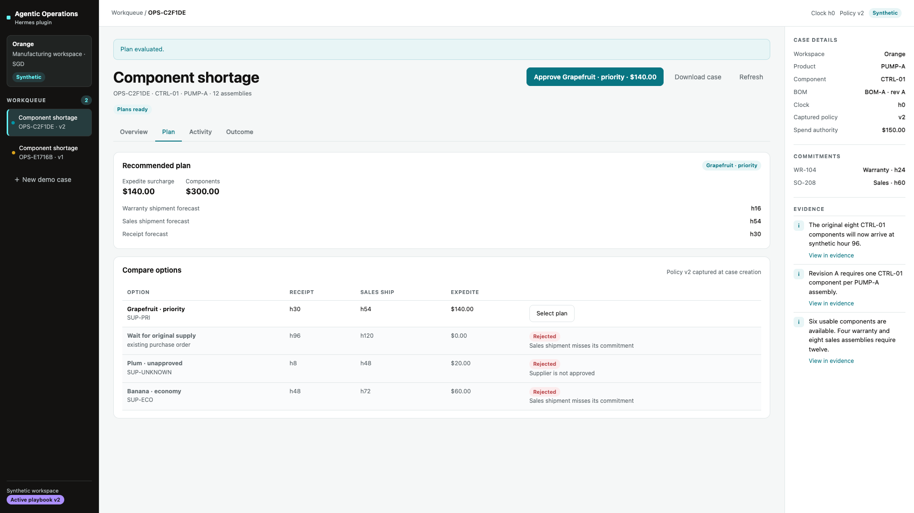

# Agentic Operations

Agentic Operations is a Hermes plugin for manufacturing shortage decisions. It compares constrained plans, persists action intent, recovers interrupted simulated purchases, and compares observed shipments with the original forecast. All business data and external actions in this release are synthetic.

[Watch the 82-second demo](https://github.com/ryanteoyx/agentic-operations/releases/download/v0.1.0/agentic-operations-82s.mp4) · [Release and evidence](https://github.com/ryanteoyx/agentic-operations/releases/tag/v0.1.0) · [Hermes catalog PR](https://github.com/NousResearch/hermes-agent/pull/153990)

## What it does

A delayed component shipment puts two commitments at risk for **Orange**, the
synthetic manufacturer: a four-unit warranty replacement and an eight-unit sales
order. Six usable components are on hand. The application compares recovery
plans against supplier approval, spending authority, stock, assembly capacity,
and shipment deadlines.

- **Compare before committing.** Feasible and rejected alternatives remain
  visible, with reasons, forecasts, expedite surcharges, and component purchase
  principal shown separately.
- **Approve before executing.** Approval reserves resources and persists a
  stable action intent. Placing the simulated order is a separate operation.
- **Recover without buying twice.** An uncertain action is reconciled by its
  original identity against an independent simulated ERP store.
- **Keep the original forecast.** Source observations are compared with the
  immutable prediction, including closed cases that shipped late.
- **Correct a future estimate, not history.** An explicit, evidence-backed
  supplier-cutoff correction changes a subsequent case without changing
  spending limits or customer priority.

The four tabs are **Overview**, **Plan**, **Activity**, and **Outcome**. A
contextual primary button follows the case's next step; **Download case** exports
its public, redacted JSON snapshot. See the [operator guide](docs/operator-guide.md)
for the complete workflow.



## Quickstart: local browser demo

Requires **Python 3.11+** and the standard library:

```sh
git clone https://github.com/ryanteoyx/agentic-operations.git
cd agentic-operations
python3 demo/serve.py --port 8765 --data-dir ./artifacts/orange-demo
```

Open **http://127.0.0.1:8765**, then select **Seed demo case**.
The product needs no CDN, npm build, provider credentials, model, or Hermes
process to run this deterministic demonstration.

Use a distinct data folder for a fresh demo, such as
`./artifacts/orange-demo-2`. Reusing a folder preserves its cases and active
estimate version; creating another case does not reset it to version 1.
Do not overwrite an existing demo or another user's data. The server is
loopback-only; do not expose it through a public reverse proxy.

## Install in Hermes

Requires **Hermes >=0.23.1**. Review the checkout before installing, and pin its
full revision rather than a moving branch. The revision must be published in
the remote repository for the pinned install to resolve.

```sh
PLUGIN_SHA="dd4a6cf563a03b65231e30f3b32338ab1fe5a113"
hermes plugins install 'ryanteoyx/agentic-operations#plugin/hermes_ops' --ref "$PLUGIN_SHA" --enable
hermes tools list
hermes ops seed
hermes ops list
hermes dashboard --host 127.0.0.1 --port 9119 --no-open
```

The plugin registers the **`agentic_operations`** toolset with eleven tools and
the **`hermes ops`** CLI. Runtime code is self-contained in
[`plugin/hermes_ops/`](plugin/hermes_ops/); installed copies do not depend on
repository siblings. Tools, CLI, and browser routes use the same core services.
Business state is stored in the active Hermes profile's plugin data directory,
not in the installation tree. The [plugin README](plugin/hermes_ops/README.md)
lists all eleven tools and their integration boundaries.

Local native validation, registration, CLI use, and authenticated HTTP access
have been exercised. The native web dashboard's **Operations** workflow at
`/operations` passed from seed through correction using the public SDK's
`authedFetch`: authenticated requests returned 200 with no 401s or JavaScript
errors, while anonymous plugin UI access remained 401. Native Desktop
integration is not implemented. Validate the exact pinned revision before
deployment; see the
[verification record](docs/devin-harness.md#product-verification-record).

## Expected synthetic outcomes

Supplier labels are **Banana · economy**, **Grapefruit · priority**, and
**Plum · unapproved**. Their stable supplier IDs remain `SUP-ECO`, `SUP-PRI`,
and `SUP-UNKNOWN`; the labels do not change the connector contract.

| Case | Sales forecast | Sales observation | Sales deadline | Warranty shipment |
| --- | --- | --- | --- | --- |
| Version 1, Banana economy | h48 | h72 | h60; 12 hours late | h16 |
| Version 2, Grapefruit priority | h54 | h54 | h60; on time | h16 |

These are fixed synthetic fixture results covered by tests. Version 1 omits a
missed supplier cutoff: receipt is
24 hours later than forecast, producing a +24-hour sales forecast error.
The correction makes economy infeasible for the next case, so priority is
recommended instead. The first case's h48 prediction remains unchanged.

All money is represented internally as integer SGD cents. Economy's
`6000` (**SGD 60**) and priority's `14000` (**SGD 140**) are incremental
expedite surcharges, **not total purchase values**. The six-component purchase
principal is `30000` (**SGD 300**) separately. The original eight-unit purchase
order is not cancelled and remains due at h96.

These fixtures demonstrate decision and recovery behavior. They are not
evidence of real manufacturing ROI, working-capital savings, or cash-flow gains.

## Reproduce the recovery scenario

From the repository root:

```sh
python3 demo/run_demo.py --artifacts ./artifacts/recovery-proof
```

By default the harness creates a fresh temporary data directory. Choose a new
artifact directory for each retained run. It selects the v1 economy plan,
persists intent, and starts an owned child process that exits with code **73**
after the simulated ERP commits but before local acknowledgement. A fresh
process reconciles the same action to **one purchase order**. The harness then
checks the v1 outcome, activates the correction, checks the v2 priority outcome,
and checks that the original forecast is preserved.

Stage JSON files and `result.json` are written to the artifact directory.
There is no public crash button or crash parameter on a tool or HTTP route;
the harness interrupts only its own child, not the Hermes host. It does not
exercise a model worker or establish duplicate safety for a production ERP.

## Model-assisted review is optional

In an active Hermes turn, `ops_investigate` can review supplied case evidence
using the host's configured model. It is one bounded **no-tools model task**,
not an autonomous subagent or multi-agent workflow. It cannot purchase, change
constraints, activate a correction, or create authoritative observations.

The deterministic demo works without it. A live provider/model investigation
has not been attempted in the isolated verification profile, which lacks
provider credentials; tests use model stubs. Failure or unavailability is
recorded as a failed task, not substituted with a fabricated review.

## Tests and operating limits

```sh
python3 -m unittest discover -s tests -p 'test_*.py' -v
```

[CI](.github/workflows/ci.yml) runs the contract suite on Python 3.11 and 3.14
without an install-dependencies step. The optional FastAPI route test skips
when Hermes host dependencies are absent; the standalone product does not
require them. Exact local results and separate native-host coverage are in
the [harness record](docs/devin-harness.md#product-verification-record).

This release is a **single-host, SQLite-backed synthetic pilot** with an
independent simulated ERP database. Production ERP connectors, Temporal,
Postgres, company-wide shared memory, RBAC, and native Desktop integration are
not implemented. Normal Hermes dashboard authentication is not a substitute
for company authorization. See the
[company deployment guide](docs/company-deployment.md) for architecture and
pilot requirements, not a claim of production readiness.

## Documentation

- [Operator guide](docs/operator-guide.md) — workflow, approval, recovery,
  evidence review, and troubleshooting.
- [Plugin reference](plugin/hermes_ops/README.md) — tools, CLI, and host boundaries.
- [Contracts](docs/contracts.md) — service interfaces, fixture, and invariants.
- [Thesis](docs/thesis.md) — product rationale and design choices.
- [Company deployment](docs/company-deployment.md) — company pilot requirements.
- [Development harness](docs/devin-harness.md) — setup and verified status.
- [Backlog](docs/backlog.md) — planned work and ownership.
- [Research sources](docs/research-sources.md) — references and their limits.
- [Submission](docs/submission.md) — release and submission requirements.
- [Optional video toolchain](demo/video/README.md) — capture and rendering
  dependencies, kept separate from the installed plugin.

## License

[MIT](LICENSE).
